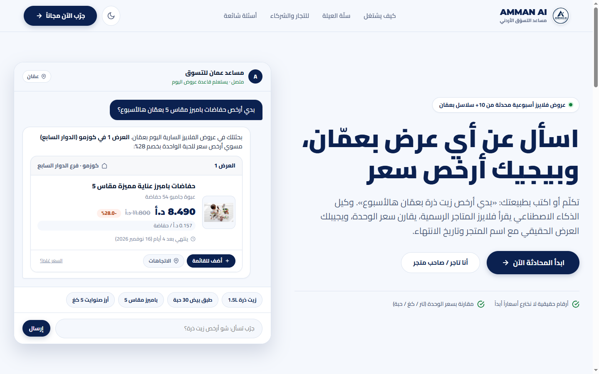
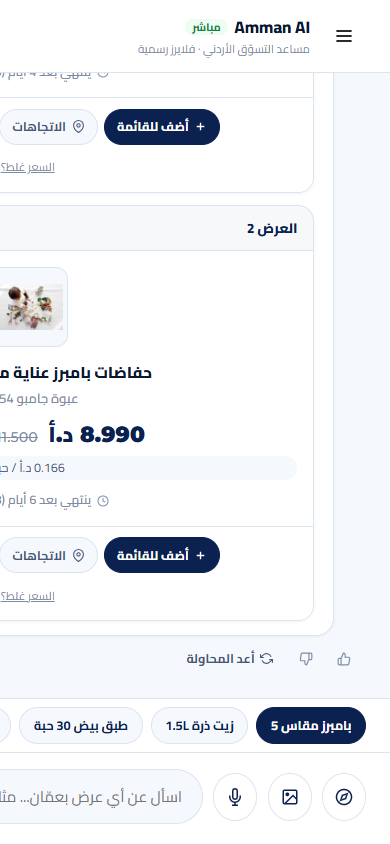
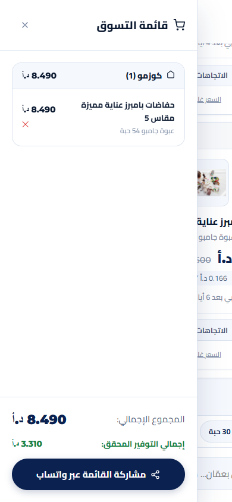
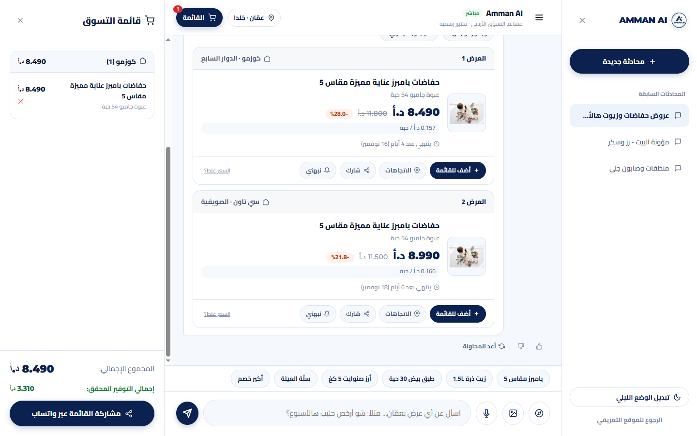

# 🛒 Amman AI — مساعد التسوّق الأردني الذكي

> مساعد تسوّق أردني بواجهة محادثة ذكية: المستخدم يكتب أو يسجّل صوته «بدي أرخص زيت ذرة بعمّان هالأسبوع»، والوكيل يحوّل الجملة إلى فلاتر دقيقة، يستعلم قاعدة بيانات الفلايرز الرسمية، ويرد بنتائج موثوقة مع اسم المتجر وتاريخ الانتهاء ومقارنة سعر الوحدة.

---

## 📸 نظرة عامة على الواجهات (UI Preview)

| الصفحة التعريفية (Desktop 1440px) | شاشة المحادثة (Mobile 390px) |
|:---:|:---:|
|  |  |

| سلة التسوق حسب المتجر | محادثة سطح المكتب (Desktop App) |
|:---:|:---:|
|  |  |

---

## ✨ المميزات الرئيسية

1. **الاستعلام باللهجة الأردنية والعامية:** يدعم البحث الصوتي والنصي («ليرة»، «ببلاش»، «هالأسبوع»، «نص ليرة»).
2. **القاعدة الذهبية:** لا نخترع أسعاراً أبداً؛ كل رقم يخرج من قاعدة البيانات مع المتجر وتاريخ الانتهاء.
3. **مقارنة سعر الوحدة:** مقارنة سعر اللتر أو الكيلو أو الحفاضة الواحدة لكشف الحجم الأكثر توفيراً.
4. **سلّة العيلة الأسبوعية + عدّاد التوفير:** توزيع مقاضي البيت بين المتاجر مع حساب كلفة المشوار (0.750 د.أ كحد أدنى للتوفير).
5. **قائمة التسوق التلقائية:** مجمّعة حسب المتجر مع حساب المجموع التراكمي وميزة المشاركة عبر واتساب.
6. **بوابة التجار المؤسسين:** رفع الفلاير ونشره آلياً خلال دقائق عبر Vision AI.

---

## 📂 هيكل المشروع (Project Structure)

```text
amman/
├── index.html                   # الصفحة التعريفية الرئيسية (Landing Page - 7 أقسام)
├── app.html                     # تطبيق المحادثة الذكي (PWA Chat Application)
├── site.webmanifest             # ملف تثبيت PWA للأجهزة الذكية
├── amman_ai_logo.jpg            # الهوية البصرية وشعار Amman AI الرسمي
├── amman_ai_schema.sql          # مخطط قاعدة بيانات PostgreSQL (38 جدولاً + pgvector + PostGIS)
├── amman_ai_merchants_tracker.xlsx # جدول متابعة وتأهيل الشركاء المؤسسين الـ 50
├── Amman_AI_Analysis_Design.docx   # التحليل الفني ودراسة ClicFlyer
├── assets/
│   ├── css/
│   │   └── style.css            # نظام التصميم (Cairo + Montserrat + Dark Mode + RTL)
│   ├── js/
│   │   ├── landing.js           # تفاعلات الصفحة الرئيسية ومحاكاة المحادثة في Hero
│   │   └── app.js               # محرك تطبيق المحادثة والوكيل وقائمة التسوق
│   └── images/
│       └── logo.jpg             # الشعار بدقة عالية
├── workflows/
│   └── wf4_ai_agent.json        # سير عمل n8n للوكيل الذكي (AI Agent Webhook)
└── docs/
    └── screenshots/             # لقطات شاشات الاختبار (Desktop & Mobile)
```

---

## 🛠️ البنية التقنية (Tech Stack)

- **الواجهة الأمامية:** HTML5, CSS3 Custom Properties (Design System), JavaScript ES6+ (Mobile-First, PWA).
- **الخطوط:** Cairo (عربي) و Montserrat (أرقام ولاتيني).
- **محرك الأتمتة والوكيل:** n8n Workflow Automation (Queue Mode + Streaming).
- **قاعدة البيانات:** PostgreSQL 16+ مع الامتدادات:
  - `pgvector`: للبحث الدلالي بالمتجهات (1536 أبعاد).
  - `PostGIS`: لحساب المسافات ومطابقة فروع المتاجر القريبة.
  - `pg_trgm`: لمطابقة الأخطاء الإملائية وأسماء المنتجات.
- **استخراج الفلايرز:** Vision AI + OCR Structured Output Parsing.

---

## 🚀 التشغيل السريع (Quick Start)

1. **تشغيل الواجهة محلياً:**
   ```bash
   # باستخدام Python
   python -m http.server 8085
   # افتح المتصفح على:
   http://localhost:8085/index.html   # الصفحة التعريفية
   http://localhost:8085/app.html     # تطبيق المحادثة
   ```
2. **استيراد قاعدة البيانات:**
   ```bash
   createdb amman_ai
   psql -d amman_ai -f amman_ai_schema.sql
   ```
3. **استيراد سير العمل في n8n:**
   - قم باستيراد ملف `workflows/wf4_ai_agent.json` في منصة n8n.
   - اضبط اعتمادات Gemini أو OpenAI.
   - فعّل الـ Webhook على المسار `POST /amman-ai-chat`.

---

## 📄 الترخيص والمصداقية

جميع الحقوق محفوظة © 2026 Amman AI — عمّان، المملكة الأردنية الهاشمية.
